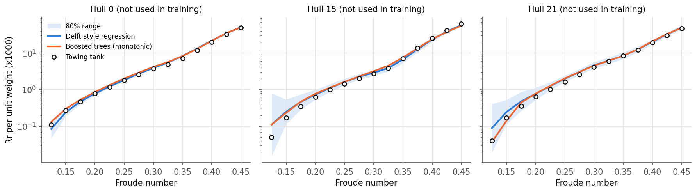
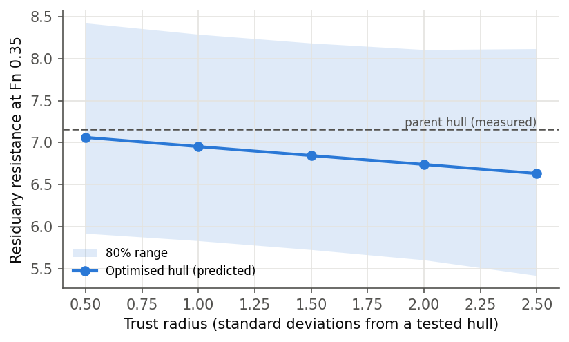
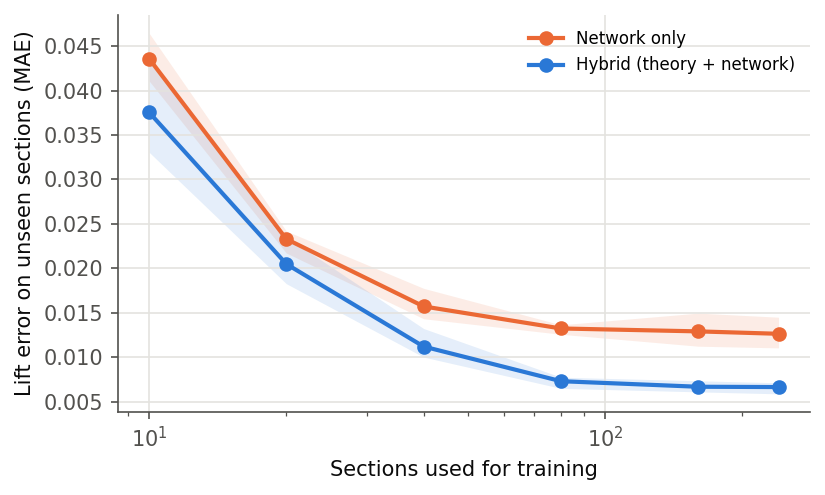
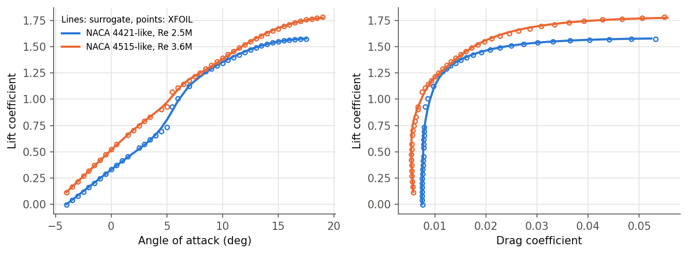
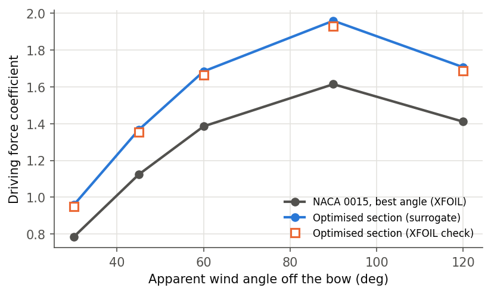

# Marine Surrogates

Fast, physics-aware models for two early-stage ship design questions:

1. **Hull resistance**: how much residuary resistance will a new hull form have, from towing-tank data?
2. **Rigid wingsail sections**: which section shape and angle give the most driving force for a given apparent wind, from XFOIL simulations?

Both parts follow the same approach: test on designs the model has never seen, use physics where it is reliable, report uncertainty honestly, and check any "optimised" design back against the data or the solver before trusting it.

## Results at a glance

| | Result |
|---|---|
| Hull resistance, unseen hull forms (leave-one-hull-out, 22 hulls) | median error **6.2%** (boosted trees, monotonic in speed) and **6.8%** (Delft-style regression), against **8.2%** for a speed-only baseline; **3.9%** at Fn ≥ 0.3 |
| Hull uncertainty ranges | raw bootstrap ranges covered only **44%** of measurements; after calibration on the other hulls, **79.5%** for an 80% target |
| XFOIL verification | lift and drag at 160 panels within **0.5%** and **0.7%** of a 320-panel run |
| XFOIL against thin aerofoil theory | zero-lift angle within **0.16°** (median over 300 sections) |
| Sail surrogate, unseen sections | lift error (MAE) **0.0066** for the hybrid model against **0.0126** for a network alone; drag median error **1.0%** |
| Data efficiency | the hybrid trained on **40** sections predicts lift better than the network alone trained on **240** |
| Optimised wingsail sections, checked in XFOIL | surrogate and solver agree within **1–2%**; about **20%** more driving force than a symmetric NACA 0015 at its best angle, across apparent wind angles from 30° to 120° |

## Part 1: hull resistance

**Data.** The Delft Systematic Yacht Hull Series (Gerritsma, Onnink and Versluis, 1981; via the UCI Machine Learning Repository): 308 towing-tank measurements, 22 hull forms, each towed at 14 Froude numbers from 0.125 to 0.45. Inputs are the longitudinal centre of buoyancy, prismatic coefficient, length-displacement ratio, beam-draught ratio and length-beam ratio. The target is residuary resistance per unit weight of displacement.

**Data checks.** All 22 hulls have complete curves and resistance rising with speed. Two hulls with different forms have identical resistance curves, most likely a copying error in the source table. They are kept, and the issue is reported.

**Models**, all on log(resistance) because it spans four orders of magnitude:

- *Speed only*: the average curve of the training hulls. Any model has to beat this.
- *Delft-style regression*: a separate linear model in the form parameters at each speed. This mirrors how the series is summarised in naval architecture.
- *Boosted trees*: with and without a hard constraint that resistance rises with speed.

**Testing.** Each hull is predicted by models trained on the other 21, so every score is for a hull form the model has never seen.



| Model | Median error | Median error, Fn ≥ 0.3 |
|---|---|---|
| Speed only (baseline) | 8.2% | 7.2% |
| Delft-style regression | 6.8% | 4.9% |
| Boosted trees | 5.6% | 4.1% |
| Boosted trees + monotonic speed | 6.2% | 3.9% |

None of the models produced a dip in resistance with speed on a dense speed sweep, so here the monotonic constraint acts as a guarantee rather than an accuracy gain. Speed explains most of the variation. The form parameters reduce the remaining error by about a quarter.

A small neural network with a physics penalty was also tried. With only 22 hulls it did not beat these simpler models, so it is not used for the hull. The neural network is used in Part 2, where simulation data is plentiful.

**Uncertainty.** Each prediction gets a spread from refitting the Delft-style regression on 200 resampled sets of hulls. On its own this was too narrow: 44% coverage for a nominal 80% range. The spread is therefore scaled on the other 21 hulls and checked on the held-out hull (cross-conformal), which gives 79.5% coverage.

**Optimisation.** The goal is the lowest resistance at Fn 0.35, with length-displacement ratio fixed, so the optimiser cannot just make the hull slimmer. Left free, it pushes every parameter to the edge of the tested range at once, a combination the series never tested. The bootstrap cannot see interactions the data never contained, so a trust region keeps the design within a set distance of a tested hull:



Within 1 standard deviation of a tested hull, the predicted resistance is 6.95 against 7.16 for the parent hull, about 3% lower. The calibrated 80% range (5.8 to 8.3) still includes the parent's value. **The honest conclusion is that this data cannot confirm a gain of that size.** The candidate would need CFD or a tank test, which is exactly where a physics-based model is needed.

## Part 2: rigid wingsail sections

**Simulation data.** XFOIL (Drela, MIT) couples a panel method for the outer flow with an integral boundary-layer model, including laminar-to-turbulent transition. 300 NACA 4-digit sections were spread across the design space with a Latin hypercube:

- camber 0–6%, camber position 20–60% of chord, thickness 9–21%;
- Reynolds number 1–10 million (a wingsail with a chord of a few metres in a moderate wind);
- angles from −4° to 20°, sweeping up and down from 0° with a fresh boundary layer each way.

96% of the 14,700 points converged. Unconverged points, and points beyond the angle of maximum lift, are not used, because XFOIL is not reliable past stall.

**Verification and validation of the solver runs**:

- *Panel convergence*: NACA 0012 and NACA 4412 at 80 to 320 panels. At the 160 panels used, lift and drag are within 0.5% and 0.7% of the 320-panel result (`data/xfoil_panel_convergence.csv`).
- *Thin aerofoil theory*: at small angles, XFOIL's zero-lift angle matches theory within 0.16° (median). The lift slope is about 0.89 of the ideal 2π per radian, as expected once viscosity and thickness are included (`results/xfoil_vs_theory.csv`).

**Surrogate.** A neural network predicts lift and log(drag) from camber, camber position, thickness, angle and log(Reynolds number). In the **hybrid** version, thin aerofoil theory gives the lift and the network learns only the correction, so the physics carries what it gets right and the data adds viscous and thickness effects. Testing is on 60 sections never used in training.



The hybrid is more accurate at every training size. With all 240 training sections it halves the lift error (0.0066 vs 0.0126). With 40 sections it already beats the network alone trained on all 240.



**Section optimisation.** For each apparent wind angle, the optimiser looks for the camber, camber position, thickness and angle of attack that maximise driving force along the ship's heading (lift × sin β − drag × cos β). Two constraints apply:

- thickness at least 12%, so the section can hold a mast or spar;
- the angle kept 2° below the predicted stall, because the wind at sea keeps changing.

Every optimum is then **run in XFOIL** to check the surrogate's answer.



| Apparent wind angle | Driving force, surrogate | Driving force, XFOIL check | NACA 0015, best angle |
|---|---|---|---|
| 30° | 0.958 | 0.949 | 0.785 |
| 45° | 1.366 | 1.355 | 1.123 |
| 60° | 1.684 | 1.664 | 1.385 |
| 90° | 1.959 | 1.930 | 1.614 |
| 120° | 1.706 | 1.685 | 1.411 |

## Limitations and next steps

- **Optima sit on the design-space boundary.** Camber at 6% and camber position at 20% mean the true optimum lies outside the space explored. A fixed cambered section also only works on one tack, which is why real rigid sails get camber from a flap. Next steps: two-element (flapped) sections and a wider design space.
- **XFOIL's limits.** The results are 2D, near stall they are less reliable, and the transition jump at low angles is smoothed by the surrogate (visible in the polar figure). Next steps: 3D effects (aspect ratio, induced drag), and RANS CFD checks of the optimised sections.
- **The hull data comes from one systematic series** that varies one parameter at a time. Interactions between parameters are untested, which is why the hull optimiser is limited by a trust region and its result is a candidate rather than a design.
- **Coupling the two parts.** Sail thrust reduces the resistance the engine must overcome, so the natural next step is a combined estimate of power saving for a given route and wind climate.

## Run it

```bash
python -m venv .venv && .venv/bin/pip install -r requirements.txt
.venv/bin/python -m marine.pipeline     # writes results/ and the figures (~20 min on a laptop CPU)
.venv/bin/python -m pytest -q
```

The XFOIL polars are included in `data/`, so the pipeline runs without XFOIL installed. To regenerate them, build the XFOIL Python bindings ([DARcorporation/xfoil-python](https://github.com/DARcorporation/xfoil-python), needs gfortran and CMake), then run `python -m marine.pipeline --rerun-xfoil`.

## Layout

```
marine/hull.py       hull data checks, models, leave-one-hull-out test, uncertainty, trust-region optimiser
marine/foil.py       NACA 4-digit geometry and thin aerofoil theory
marine/sail.py       XFOIL runs, solver checks, hybrid surrogate, section optimiser and XFOIL check
marine/figures.py    figures
marine/pipeline.py   runs everything and writes results/
tests/               unit tests
```

## Data sources

- Gerritsma, J., Onnink, R. and Versluis, A. (1981). *Geometry, resistance and stability of the Delft Systematic Yacht Hull Series.* Data via the UCI Machine Learning Repository (Yacht Hydrodynamics).
- Drela, M. (1989). *XFOIL: An analysis and design system for low Reynolds number airfoils.*
